<!-- Sequence: hero, what I do, toolkit, practice projects, learning, GitHub stats, pets, connect.
     The seven pipeline strips sit between them, so the detective cat moves
     from "New" to "Closed" as the visitor scrolls. -->

<!-- ========================================================= -->
<!--                          HERO                             -->
<!-- ========================================================= -->

  


<!-- ========================================================= -->
<!--                        WHAT I DO                          -->
<!-- ========================================================= -->

  


<!-- ========================================================= -->
<!--                        TOOLKIT                            -->
<!-- ========================================================= -->

  


<!-- ========================================================= -->
<!--                    PRACTICE PROJECTS                      -->
<!-- ========================================================= -->

  


<!-- ========================================================= -->
<!--                        LEARNING                           -->
<!-- ========================================================= -->

  


<!-- ========================================================= -->
<!--                      GITHUB STATS                         -->
<!-- ========================================================= -->

<!-- stats.svg and the snake are generated daily by .github/workflows/snake.yml -->

  

  


<!-- ========================================================= -->
<!--                          PETS                             -->
<!-- ========================================================= -->

  


<!-- ========================================================= -->
<!--                        CONNECT                            -->
<!-- ========================================================= -->

  <a href="https://ayesha.online">
    
  </a>

  
  
  
  

